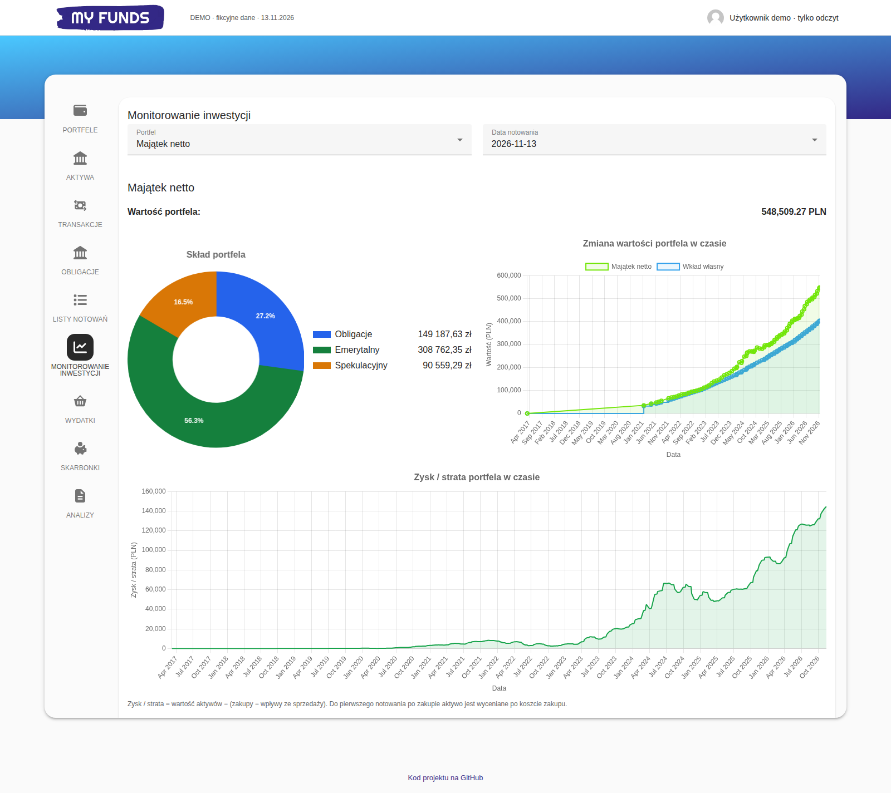

# My Funds Demo

A full-stack personal finance application for tracking investments, expenses and savings goals. This public showcase uses **fictional data only**.

**Live demo:** [my-funds-demo.pages.dev](https://my-funds-demo.pages.dev/)



## Features

- Portfolio valuation, asset allocation, contributions and profit over time.
- Stocks, ETFs, Bitcoin and retail bonds, with transaction and quote history.
- Expense budgets, search, reports, CSV/JSON export and savings goals.

## Tech stack and architecture

- **Backend:** Scala 3, ZIO, ZIO HTTP, Doobie, PostgreSQL and Flyway.
- **Frontend:** Angular, TypeScript, Angular Material and Chart.js.
- **Tooling:** Docker Compose, GitHub Actions and ZIO Test.

The local application runs as **Angular → Nginx → Scala API → PostgreSQL**, with database migrations applied at startup. The static showcase shares the UI and API response shapes, but an HTTP interceptor serves reads from JSON fixtures and computes expense filters and reports in the browser. Editing is disabled and mutation requests are blocked before reaching the network; no backend or credentials are required.

The fictional valuation date is **13 November 2026**: bonds **149,187.63 PLN**, retirement **308,762.35 PLN** and speculative investments **90,559.29 PLN** — **548,509.27 PLN** total. Portfolio values and weights come from non-round model prices, not fixed rounded allocations; see [the scenario and export workflow](docs/demo-data.md).

## Run locally

Requires **Docker with Compose**. No local Java, Scala or Node.js installation is needed.

```sh
git clone https://github.com/dawidkobak/my-funds-demo.git
cd my-funds-demo
docker compose up -d
```

Open **http://localhost:9083**. First startup downloads dependencies, compiles the application and seeds an isolated demo database; allow a few minutes.

```sh
docker compose logs --tail 50 mf-node mf-sbt-api  # Startup logs
docker compose down                              # Stop; keep local database data
```

### Static preview and Cloudflare Pages

With the local stack running, build and preview the read-only showcase:

```sh
docker compose exec mf-node npm run build:demo
docker compose --profile preview up -d mf-static
```

Open **http://localhost:9084**. For Cloudflare Pages, use:

| Setting | Value |
| --- | --- |
| Root directory | `front` |
| Build command | `npm ci --no-audit && npm run build:demo` |
| Build output directory | `dist/my-funds-demo` |
| Environment variable | `NODE_VERSION=24` |

The static dataset and SPA redirect configuration are included in the repository. The first release can also be uploaded as a prebuilt ZIP; see [Cloudflare release preparation](docs/cloudflare-pages.md).

## Development and checks

Source code lives in `backend/api` and `front`; versioned SQL migrations are under `backend/api/src/main/resources/db/migration`.

```sh
docker compose exec mf-sbt-api sbt "api/compile" "api/test"
docker compose exec mf-node sh -lc 'npm run compile && npm run lint && npm test && npm run build && npm run build:demo'
```

Database integration tests require separate test databases and environment variables; see the [CI workflow](.github/workflows/verify.yml) for setup and automated checks. Browser checks are manual; no end-to-end browser suite is included.

Public export/generation tools and their Python regression tests live in `tools/`; the root `scripts/` directory is local-only and ignored.

Further details: [documentation index and design decisions](docs/README.md) · [demo data and fixture export](docs/demo-data.md) · [dependency compatibility](docs/dependencies.md) · [verification records](docs/verification.md).
